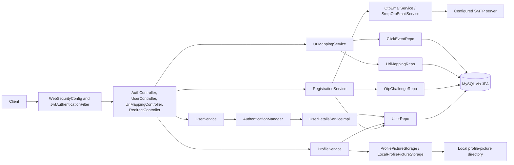
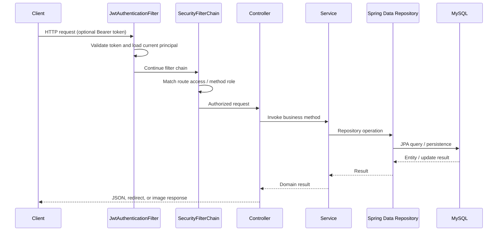
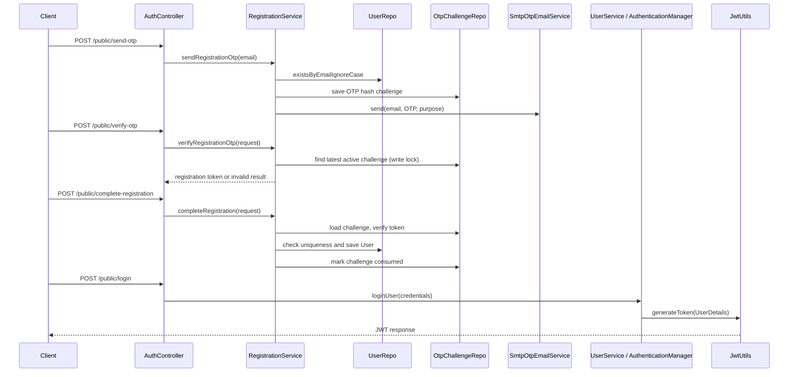
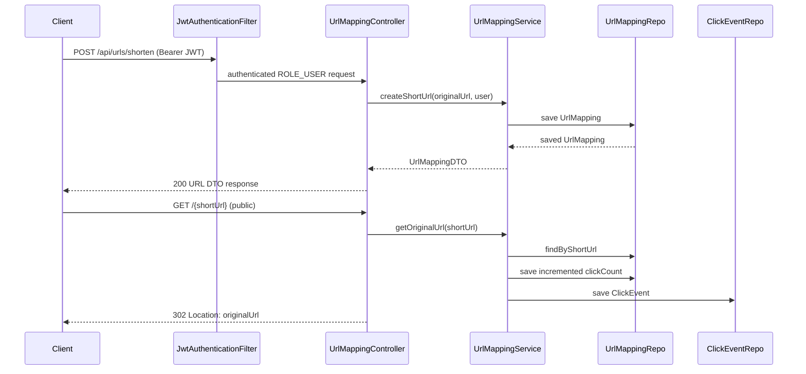

# Backend Workflow and Architecture

## 1. Document Scope and Safety Rules

This document describes behavior inferred from the checked-in backend source and configuration. No application, database, migration, seed script, build, or test was run for this analysis. It does not expose credential values or token/OTP material. Runtime effects and environment-dependent behavior are explicitly identified as unverified.

The project root did not contain `workflow.md` when inspected. This is the only file created for this report; existing application, configuration, test, and documentation files were not edited.

## 2. Backend Overview

This is a Java 17 Spring Boot REST backend for URL shortening, user authentication, OTP-backed registration and email change, profile maintenance, profile-picture storage, and click analytics. The application entry point is `com.uss.UrlShortnerSbApplication`; web controllers, services, repositories, JPA entities, and security configuration are under `src/main/java/com/uss`.

The primary request paths are:

- Authentication and registration: `AuthController` → `RegistrationService` / `UserService` → JPA repositories and SMTP integration.
- User profile operations: `UserController` → `ProfileService` or `RegistrationService` → `UserRepo`, with profile-picture bytes handled by `ProfilePictureStorage`.
- URL management and analytics: `UrlMappingController` → `UrlMappingService` → `UrlMappingRepo` / `ClickEventRepo`.
- Public redirect: `RedirectController` → `UrlMappingService` → `UrlMappingRepo` and `ClickEventRepo`.

The companion `FRONTEND_API_CONTRACT.md` is useful for client expectations but is not treated as authoritative where it differs from implementation. For example, the implementation does use a pessimistic lock for OTP challenge lookups, but does not check URL ownership in the analytics-by-short-code route.

## 3. Technology Stack

Dependencies declared in `pom.xml` include:

- Spring Boot 4.0.7 and Java 17.
- Spring MVC (`spring-boot-starter-webmvc`), Spring Security, Bean Validation, and Spring Data JPA.
- MySQL Connector/J at runtime.
- Spring Mail for OTP delivery.
- JJWT 0.13.0 for signed JWTs.
- Springdoc OpenAPI UI.
- Lombok (optional; used for generated accessors/constructors).
- Spring Boot web MVC test support and JUnit/Mockito usage in tests.

## 4. Project Structure

| Package / path | Responsibility |
|---|---|
| `src/main/java/com/uss` | Spring Boot application entry point |
| `com/uss/controller` | REST endpoints, redirects, and REST exception mapping |
| `com/uss/service` | Authentication, URL behavior, registration, profiles, storage and email services |
| `com/uss/repository` | Spring Data JPA repository interfaces |
| `com/uss/models` | JPA entities |
| `com/uss/bindings` | Request/response DTOs |
| `com/uss/security` and `com/uss/security/jwt` | Security filter chain and JWT handling |
| `com/uss/config` | CORS and OpenAPI configuration |
| `src/main/resources/application.properties` | Server, database, JPA, JWT, mail, storage and multipart settings |
| `src/test/java` | Registration-service and application-context/MVC tests (inspected, not run) |

## 5. Application Startup Workflow

1. `UrlShortnerSbApplication.main` calls `SpringApplication.run(UrlShortnerSbApplication.class, args)`.
2. `@SpringBootApplication` enables Boot auto-configuration and component scanning from `com.uss`, including subpackages. Annotated controllers, services, repositories and configuration classes are registered as beans.
3. Spring resolves constructor dependencies (and the few field-injected dependencies) such as repositories, `PasswordEncoder`, `AuthenticationManager`, `JavaMailSender`, storage abstraction and `JwtUtils`.
4. `WebSecurityConfig` contributes the `SecurityFilterChain`, DAO authentication provider, `AuthenticationManager`, BCrypt encoder and JWT filter beans. `CorsConfig` contributes the CORS source; `OpenAPIConfig` contributes the OpenAPI definition.
5. Spring Boot's JPA auto-configuration configures the MySQL datasource from `application.properties`, discovers entity/repository types, and initializes Hibernate/JPA. `spring.jpa.hibernate.ddl-auto=update` requests schema update behavior at startup; no schema update was executed during this analysis.
6. Spring Boot configures the embedded web server on the configured port (8080 in the checked-in properties) and registers MVC mappings, servlet/security filters and exception advice.
7. No `ApplicationRunner`, `CommandLineRunner`, explicit startup hook, `@Scheduled`, or `@Async` workflow was found in the inspected Java source. No custom scheduled/background task is documented.

Startup depends on a reachable/configured database and resolvable property placeholders. In particular, SMTP and JWT configuration are injected into beans; exact runtime readiness depends on deployment-provided values. Profile storage selects the local implementation by default. An unsupported provider value has no matching `ProfilePictureStorage` bean in this code and is expected to prevent dependency injection/startup; this is inferred from conditional bean registration, not runtime-tested.

## 6. Architecture and Component Responsibilities

- **Controllers:** `AuthController`, `UserController`, `UrlMappingController`, and `RedirectController` bind HTTP requests and construct responses.
- **Services:** `RegistrationService` coordinates OTP workflows and user creation; `UserService` authenticates logins; `ProfileService` handles profile/password/picture behavior; `UrlMappingService` creates short links, resolves redirects, and aggregates click records.
- **Persistence:** `UserRepo`, `OtpChallengeRepo`, `UrlMappingRepo`, and `ClickEventRepo` are Spring Data JPA repositories.
- **Security:** `WebSecurityConfig` defines route access and error responses; `JwtAuthenticationFilter` reads bearer tokens and populates the Spring Security context; `JwtUtils` parses, validates and signs JWTs; `UserDetailsServiceImpl` loads persisted principals.
- **Integrations:** `SmtpOtpEmailService` sends OTP email through Spring `JavaMailSender`; `LocalProfilePictureStorage` stores image bytes on the local filesystem through `ProfilePictureStorage`.

## 7. API Endpoint Inventory

Route security below reflects `WebSecurityConfig` and method annotations. URLs are relative to the application origin (configured port 8080). JSON serialization is provided by Spring MVC. Unless a more specific handler is listed, exceptions are not guaranteed to use the JSON shape returned by `ApiExceptionHandler`.

| Method | Endpoint | Controller | Authentication | Purpose | Request | Response |
|---|---|---|---|---|---|---|
| `POST` | `/api/auth/public/send-otp` | `AuthController.sendRegistrationOtp` | Public | Start registration OTP | `SendOtpRequest` JSON (`email`) | `202`, `ApiMessageResponse` |
| `POST` | `/api/auth/public/verify-otp` | `AuthController.verifyRegistrationOtp` | Public | Verify registration OTP | `VerifyOtpRequest` JSON (`email`, `otp`) | `200`, map with `verified` and `registrationToken` |
| `POST` | `/api/auth/public/complete-registration` | `AuthController.completeRegistration` | Public | Create account after OTP verification | `CompleteRegistrationRequest` JSON | `201`, `UserProfileResponse` |
| `POST` | `/api/auth/public/login` | `AuthController.loginUser` | Public | Authenticate username/password | `LoginRequest` JSON | `200`, `JwtAuthenticationResponse` (`token`) |
| `GET` | `/api/users/me` | `UserController.getProfile` | Authenticated | Read current user's profile | No body | `200`, `UserProfileResponse` |
| `PATCH` | `/api/users/me` | `UserController.updateProfile` | Authenticated | Change username | `UpdateProfileRequest` JSON | `200`, `UserProfileResponse` |
| `POST` | `/api/users/me/profile-picture` | `UserController.uploadProfilePicture` | Authenticated | Upload a profile image | Multipart part `file` | `200`, `ApiMessageResponse` |
| `GET` | `/api/users/me/profile-picture` | `UserController.getProfilePicture` | Authenticated | Download current profile image | No body | `200`, image bytes |
| `DELETE` | `/api/users/me/profile-picture` | `UserController.deleteProfilePicture` | Authenticated | Remove current profile image | No body | `204`, empty |
| `PATCH` | `/api/users/me/password` | `UserController.changePassword` | Authenticated | Change password | `ChangePasswordRequest` JSON | `200`, `ApiMessageResponse` |
| `POST` | `/api/users/me/email-change/send-otp` | `UserController.sendEmailChangeOtp` | Authenticated | Send OTP to proposed email | `SendOtpRequest` JSON | `202`, `ApiMessageResponse` |
| `POST` | `/api/users/me/email-change/verify-otp` | `UserController.verifyEmailChangeOtp` | Authenticated | Verify OTP and update email | `VerifyOtpRequest` JSON | `200`, map with `email` and `verified` |
| `POST` | `/api/urls/shorten` | `UrlMappingController.createShortUrl` | Authenticated; additionally `ROLE_USER` | Create owned short mapping | JSON map expected to contain `originalUrl` | `200`, `UrlMappingDTO` |
| `GET` | `/api/urls/myurls` | `UrlMappingController.getUserUrls` | Authenticated; additionally `ROLE_USER` | List mappings for current user | No body | `200`, list of `UrlMappingDTO` |
| `GET` | `/api/urls/analytics/{shortUrl}` | `UrlMappingController.getUrlAnalytics` | Authenticated; additionally `ROLE_USER` | Aggregate clicks for one code | Path `shortUrl`; query `startDate`, `endDate` in ISO local date-time format | `200`, list of `ClickEventDTO` |
| `GET` | `/api/urls/totalClicks` | `UrlMappingController.getTotalClicksByDate` | Authenticated; additionally `ROLE_USER` | Aggregate current user's clicks by day | Query `startDate`, `endDate` in ISO date format | `200`, map of date to count |
| `GET` | `/{shortUrl}` (one path segment) | `RedirectController.redirect` | Public | Resolve and redirect short code | Path `shortUrl` | `302` with `Location`, or `404` |

`WebSecurityConfig` also permits `/v3/api-docs/**`, `/swagger-ui/**`, `/v3/api-docs.yaml`, and `/swagger-ui.html`; these are framework/documentation routes rather than controller methods. No `PUT`, URL deletion/update, direct `/register`, password-reset, or logout controller mapping was found. The redirect mapping is a root-level one-segment path and can potentially overlap other one-segment routes introduced later.

## 8. Request Lifecycle

1. The servlet container receives the request and Spring Security applies CORS and the configured filter chain.
2. `JwtAuthenticationFilter` looks for an `Authorization` header beginning with `Bearer `. If present and accepted by `JwtUtils.validateToken`, it loads the account by the token's `userId` claim, or by username for tokens without that claim, and places an authenticated token in `SecurityContextHolder`.
3. Filter-chain authorization applies the first matching route rule. Auth routes are public; `/api/users/**` and `/api/urls/**` require authentication; the short-code root GET is permitted; documentation routes are public; remaining routes require authentication. URL controller methods additionally require `ROLE_USER`.
4. MVC selects the mapped controller. `@RequestBody`, `@RequestPart`, path variables and query parameters are bound; Bean Validation runs only at controller parameters annotated with `@Valid`.
5. Controller calls service logic, which may call repositories and external storage/mail integrations.
6. Repository operations use Spring Data JPA/Hibernate and the configured MySQL datasource. Transaction boundaries are explicitly declared on registration/profile service methods where noted below; repository methods also have their own Spring Data transaction behavior.
7. The controller's return value is serialized to JSON or returned as a redirect/binary response. `ApiExceptionHandler` maps selected MVC/service exceptions; Spring Security's entry point and access-denied handler independently return the configured JSON error shape for authentication and authorization failures.

## 9. Detailed API Workflows

### 9.1 URL creation, listing and redirect

1. An authenticated user with `ROLE_USER` sends `POST /api/urls/shorten` with a JSON object containing `originalUrl`.
2. `UrlMappingController.createShortUrl` obtains the principal name and resolves a `User` using `UserService.findByUsername`.
3. `UrlMappingService.createShortUrl` generates an eight-character value from ASCII letters and digits using `java.util.Random`, creates a `UrlMapping` with the supplied original URL, current user and current local date-time, then calls `UrlMappingRepo.save`.
4. The service converts the saved entity to `UrlMappingDTO`. `convertToDTO` assigns `id`, `originalUrl`, `shortUrl` and `createdDate`; it does not set DTO `clickCount` or `username`. Therefore those fields serialize as their defaults (`0` and `null`) in this path.
5. There is no `@Valid` request DTO, URL syntax validation, alias input, duplicate-code retry, or explicit uniqueness declaration for `shortUrl` in the entity. Generated-code collisions and malformed/missing `originalUrl` handling are not explicitly guarded in service code.

For `GET /api/urls/myurls`, the controller resolves the authenticated username to a `User`; `UrlMappingService.getUserUrls` calls `UrlMappingRepo.findByUser` and converts each entity to the same partial DTO.

For a public `GET /{shortUrl}`:

1. `RedirectController.redirect` calls `UrlMappingService.getOriginalUrl`.
2. The service calls `UrlMappingRepo.findByShortUrl`. If found, it increments `clickCount`, saves the mapping, creates a `ClickEvent` with `LocalDateTime.now()` and the mapping, and saves the event.
3. The controller returns `302` with the original URL in `Location`; if the repository returns no mapping, it returns `404`.

No URL normalization/scheme validation is performed here. The service method has no explicit transaction annotation around the two saves; atomicity of increment and click-event insertion is therefore not guaranteed by a service-level transaction.

### 9.2 Click analytics

- `GET /api/urls/analytics/{shortUrl}` parses `startDate` and `endDate` using `DateTimeFormatter.ISO_LOCAL_DATE_TIME`, then calls `UrlMappingService.getClickEventByDate`. It fetches the mapping by code; if absent it returns an empty list. Otherwise it queries matching click events with `ClickEventRepo.findByUrlMappingAndClickDateBetween` and groups them by local calendar day.
- The analytics handler does not receive or resolve the authenticated user and the service does not check the mapping's owner. Any authenticated `ROLE_USER` who knows a code can request its analytics; this is implemented behavior, not an ownership guarantee.
- `GET /api/urls/totalClicks` resolves the current user, parses date-only `startDate`/`endDate`, fetches the user's mappings, and queries events from `startDate` at midnight through (exclusive) midnight after `endDate`. It groups returned rows by local date. An empty set of mappings results in an empty map.
- Date parsing failures and missing required request parameters are not explicitly caught by `ApiExceptionHandler`; their exact HTTP body/status is framework-dependent.

### 9.3 Registration, OTP and login

1. Public `POST /api/auth/public/send-otp` validates email with `@NotBlank` and `@Email`. `RegistrationService.sendRegistrationOtp` lowercases and trims it, rejects an existing email with `409`, generates a six-digit OTP using `SecureRandom`, BCrypt-hashes it, stores an `OtpChallenge`, and sends the plaintext code through `OtpEmailService`.
2. The challenge is tagged `REGISTRATION`, has a 10-minute expiry, zero failed attempts and an initially unverified state. Multiple challenges may be stored; lookups select the newest unconsumed one. The repository query uses `PESSIMISTIC_WRITE`.
3. Public `POST /api/auth/public/verify-otp` validates email and a six-digit string. `verifyRegistrationOtp` obtains the latest active challenge, rejects expired/missing/exhausted challenges, and compares the supplied code to the stored BCrypt hash. Invalid attempts increment `failedAttempts`; five failed attempts exhaust the challenge. A successful match marks it verified, stores a BCrypt hash of a fresh URL-safe random registration token, and returns that one-time token.
4. Public `POST /api/auth/public/complete-registration` validates email, username (3–50 characters matching `^[a-zA-Z0-9._-]+$`), password (8–128 characters), and nonblank registration token. `completeRegistration` requires a current verified challenge and matching token, rechecks email and username uniqueness, BCrypt-hashes the password, creates a `ROLE_USER` user, saves it, and marks the challenge consumed. Both registration methods are `@Transactional`; the challenge query has a pessimistic write lock.
5. Public `POST /api/auth/public/login` passes username/password to `AuthenticationManager`. Its DAO provider uses `UserDetailsServiceImpl` and BCrypt. `UserService.loginUser` sets the resulting authentication in the current security context, creates a JWT, and returns `{"token": ...}`.

The controller has no direct registration endpoint. Tests in `UrlShortnerSbApplicationTests` assert that missing registration token validation fails and the obsolete `/api/auth/public/register` mapping is absent; these tests were inspected but not run.

### 9.4 Profile, password and profile-picture workflows

- Profile methods first use `UserController.authenticatedUser` to load the account by `UserDetailsImpl.id`; missing account maps to `401` through `ProfileService.findAuthenticatedUser`.
- `GET /api/users/me` returns ID, email, username, and a boolean based on whether `profilePictureKey` is non-null.
- `PATCH /api/users/me` validates username, checks case-insensitive uniqueness when it changes, and saves the `User`. A same username differing only in case bypasses the duplicate check for the current account and is set as supplied.
- Password change checks the current BCrypt hash, rejects an unchanged password, hashes the replacement and saves the user. Both checks return `400` via `ApiException`.
- Picture upload accepts only declared PNG/JPEG/GIF content types, rejects an empty or >5 MiB file, decodes it with `ImageIO`, and checks the corresponding file signature. It stores bytes through `ProfilePictureStorage`, persists the returned key, then deletes the old key if present.
- Picture retrieval loads the persisted key and returns raw bytes with storage-provided media type and `Cache-Control: no-store`; absent key returns `404`.
- Picture deletion deletes the stored file, clears the key and saves the user; absent key returns `404`.

Profile service read/write methods use `@Transactional` (reads use `readOnly = true` where applicable). Filesystem changes are not part of a MySQL transaction: a later database failure can leave file and row state inconsistent.

### 9.5 Email change

1. An authenticated caller posts a valid new email to `/api/users/me/email-change/send-otp`.
2. `RegistrationService.sendEmailChangeOtp` normalizes the email, rejects the current address or an already-used address, then persists a challenge with purpose `EMAIL_CHANGE` and sends it by SMTP.
3. Authenticated `POST /api/users/me/email-change/verify-otp` validates the request and invokes `verifyEmailChangeOtp` with the currently authenticated user.
4. The method verifies the newest active challenge for that email and purpose, rechecks uniqueness, updates the current user's email, marks the challenge consumed, and saves both under a transaction. The challenge itself is selected using the repository's pessimistic write lock.

The challenge is keyed by email and purpose, not by initiating user's ID. The verifier is authenticated, but code does not bind challenge ownership to the user who requested it. That is an implementation limitation.

## 10. Authentication and Security

### Authentication mechanics

- `WebSecurityConfig` disables CSRF, enables CORS using `CorsConfig`, registers a `DaoAuthenticationProvider`, and inserts `JwtAuthenticationFilter` before `UsernamePasswordAuthenticationFilter`.
- `PasswordEncoder` is `BCryptPasswordEncoder`. The DAO provider verifies login credentials using the database-backed `UserDetailsServiceImpl`.
- `JwtUtils.generateToken` places username in `sub`, user ID in `userId`, comma-joined authority strings in `roles`, and issued-at/expiration timestamps in the signed claims. Expiry is calculated from `jwt.expiration`; checked-in configuration specifies 18,000,000 ms (five hours), despite an inline comment in `JwtUtils` describing ten hours.
- The signing key is derived by Base64-decoding `jwt.secret` and passing the bytes to the JJWT HMAC key helper. The property value is intentionally not repeated here.
- On requests, a well-formed `Bearer ` token is parsed and signature/expiration validity is checked. The filter loads current authorities from the database by `userId`; legacy tokens without that claim fall back to username. The JWT `roles` claim is not used to construct authorities.
- `UserDetailsServiceImpl.loadUserById` throws `UsernameNotFoundException` if the account no longer exists. The filter catches all exceptions, prints a stack trace and proceeds without setting authentication; the protected route then normally reaches the configured `401` entry point.

### Authentication versus authorization

Authentication establishes a principal from a valid bearer JWT. Authorization is route-based in `WebSecurityConfig` and role-based on URL controller methods via `@PreAuthorize("hasRole('USER')")`. Registration/login are public; `/api/users/**` and `/api/urls/**` require authentication. New users are assigned `ROLE_USER`.

Security entry-point and access-denied handlers write `ApiErrorResponse` JSON with status `401` or `403`, respectively, and an empty validation-errors map. `ApiExceptionHandler` separately maps `AuthenticationException` to `401` for exceptions reaching MVC.

### Session, logout and token revocation

There is no logout route, token denylist, refresh-token route, or server-side JWT revocation logic in the inspected code. No explicit `SessionCreationPolicy.STATELESS` is configured, so a stateless-session guarantee should not be inferred. No server-side action on the password-change path invalidates existing signed JWTs. Effective token/session handling beyond the custom filter is dependent on Spring Security defaults and was not runtime-tested.

### CORS

`CorsConfig` allows origin `http://localhost:5173`, methods GET/POST/PUT/DELETE/OPTIONS and all request headers, with credentials enabled. `PATCH` is not listed, although several controllers expose PATCH routes; browser cross-origin PATCH behavior therefore requires deployment/configuration verification. `WebSecurityConfig` lists `/api/users/**` authentication before the `OPTIONS /**` permit rule, so OPTIONS requests matching `/api/users/**` may be subject to the earlier authenticated matcher.

## 11. Business Logic

### URL management

`UrlMappingService` creates a random eight-character alphanumeric code, associates it with the current `User`, and records `createdDate`. There is no explicit custom alias support, validation of the original URL, duplicate detection/retry, expiration, or URL update/delete operation. No uniqueness annotation on `shortUrl` is present in `UrlMapping`.

### Redirects and clicks

Each successful resolution increments `UrlMapping.clickCount` and persists a `ClickEvent`; unknown codes produce no click write and result in 404. The redirect uses an HTTP 302 and the stored original URL directly. Analytics are derived from click-event rows, not from `clickCount`.

### User-specific data and ownership

`/myurls` and `/totalClicks` scope queries through the authenticated user's `User` entity. The individual analytics route only uses the short code and has no ownership check. No user-facing URL deletion or update behavior was found.

### Registration and profile

OTP limits, expiry and one-time registration token behavior are implemented in `RegistrationService`; profile edits and password/picture operations are in `ProfileService`. Password reset/recovery separate from authenticated password change is not implemented.

## 12. Database and Persistence

### Configuration and schema behavior

`application.properties` configures a MySQL datasource (local URL targets database `url_shortener`), the MySQL driver, Hibernate's MySQL dialect, SQL logging, and `spring.jpa.hibernate.ddl-auto=update`. Credentials and cryptographic secret values are deliberately omitted. The actual datasource's availability, schema state, and DDL effects were not checked.

### Entities

| Entity | Table mapping | Key fields and relationships |
|---|---|---|
| `User` | Explicit `users` | `id` identity PK; email and username have table-level unique constraints; username, password, role, profile-picture key. Defaults role to `ROLE_USER`. |
| `OtpChallenge` | Explicit `otp_challenges` | Identity PK; non-null email/purpose/code hash/created/expiry/failed count/verified; optional registration-token hash and consumed time; index on email, purpose, created timestamp. |
| `UrlMapping` | Default entity table name (no explicit `@Table`) | Identity PK; original URL, short URL, click count (initialized to 0), created date; `ManyToOne` user with `user_id`; `OneToMany` click events mapped by `urlMapping`. |
| `ClickEvent` | Default entity table name (no explicit `@Table`) | Identity PK, click date, `ManyToOne(fetch = LAZY)` to `UrlMapping` via `url_mapping_id`. |

JPA physical naming strategy determines exact table/column names for implicit mappings, beyond explicit names above. No explicit `User` relationship to URL mappings is declared in code (a commented-out relation is inactive); ownership is represented by `UrlMapping.user`.

### Repositories and access paths

- `UserRepo`: standard CRUD plus `findByUsername`, case-insensitive email lookup, case-insensitive existence checks for email/username.
- `OtpChallengeRepo`: selects newest unconsumed challenge for email/purpose; query is annotated `@Lock(PESSIMISTIC_WRITE)`.
- `UrlMappingRepo`: lookup by short code and list by user.
- `ClickEventRepo`: events for one mapping between timestamps; events for a collection of mappings between timestamps.

Spring Data derives query behavior from method names; no custom JPQL/native SQL or database migration scripts were found in the inspected source tree. No entity lifecycle callbacks or auditing configuration were found.

### Transactions and failure propagation

`RegistrationService` methods and most mutating `ProfileService` methods declare `@Transactional`; its profile read methods are read-only. URL service methods do not declare a service-level transaction. OTP challenge save and challenge consumption are grouped with user persistence in the transactional registration/email-change methods, but external SMTP/file operations cannot be rolled back by the database transaction.

`DataIntegrityViolationException` is translated to `409` with a generic duplicate email/username message. Other uncaught persistence exceptions have no explicit handler and follow Spring's normal exception propagation. No database writes were made for this documentation.

## 13. Validation and Exception Handling

- `SendOtpRequest`: nonblank, valid email.
- `VerifyOtpRequest`: nonblank valid email and exactly six decimal digits.
- `CompleteRegistrationRequest`: valid email, username 3–50 characters and matching the allowed-character regex, password 8–128 characters, nonblank registration token.
- `UpdateProfileRequest`: nonblank username with the same length and character restrictions.
- `ChangePasswordRequest`: nonblank current password and nonblank 8–128 character new password.
- Validation executes for controller request types annotated with `@Valid`. `LoginRequest` has no validation annotations and its controller parameter is not `@Valid`; URL creation takes a generic map and performs no declared Bean Validation.
- `ApiExceptionHandler` produces `ApiErrorResponse(timestamp,status,error,message,path,validationErrors)` for `ApiException`, validation failures, malformed body, multipart size, missing multipart part, unsupported media type, `IOException`, data integrity violation, and MVC `AuthenticationException`.
- Validation errors use the first message for each field. Malformed JSON maps to `400`; over-limit uploads to `413`; missing multipart part to `400`; unsupported media type to `415`; storage I/O failure to `500`; API exceptions use their embedded status.
- `RegistrationService` uses `400` for invalid/expired/exhausted OTP or registration token and `409` for duplicate identities. Profile logic uses `400` for bad password/current password mismatch, `404` for missing picture, `401` when the current account cannot be found, and `409` for duplicate username/email.
- Authentication/authorization failures handled at the security filter chain return JSON `401`/`403`. Missing request parameters, date parse failures, unexpected runtime failures and many low-level persistence errors have no explicit route-specific translation in the advice; precise response details are framework/runtime-dependent.

## 14. External Integrations

### SMTP email

`SmtpOtpEmailService` uses `JavaMailSender` to send registration/email-change OTPs. It sets a fixed subject and a message containing the OTP and purpose. A `MailException` is logged and converted to `ApiException(503, ...)`, which the REST advice serializes. Runtime delivery depends on mail server configuration and network reachability; it was not tested.

### Profile-picture filesystem storage

`ProfilePictureStorage` defines `store`, `load` and `delete`; `LocalProfilePictureStorage` is conditional on `app.storage.provider=local` (or property missing). It writes UUID-named files below a normalized configured root, stores only the generated key in the user row, and checks keys remain within the root. Filesystem persistence is independent of database transactions.

No cache, message broker, cloud storage, external URL service, or asynchronous integration was found in the inspected backend source.

## 15. Configuration and Environment Variables

Checked-in `application.properties` indicates:

| Property | Purpose / observed behavior |
|---|---|
| `spring.application.name` | Application name |
| `server.port` | HTTP server port (8080 in checked-in config) |
| `spring.datasource.url`, `.username`, `.password`, `.driver-class-name` | MySQL connection; sensitive values intentionally not reproduced |
| `spring.jpa.hibernate.ddl-auto` | Set to `update`; startup may alter schema |
| `spring.jpa.show-sql`, `spring.jpa.properties.hibernate.format_sql` | SQL output and formatting enabled |
| `spring.jpa.database-platform` | MySQL dialect |
| `jwt.secret` | HMAC signing secret; value intentionally omitted |
| `jwt.expiration` | JWT lifetime in milliseconds; configured as 18,000,000 ms |
| `app.otp.mail-from` / `OTP_MAIL_FROM` | OTP sender configuration; property placeholder has no default in the checked-in properties |
| `spring.mail.host` / `SMTP_HOST` | SMTP host; property supplies a default |
| `spring.mail.port` / `SMTP_PORT` | SMTP port; property supplies a default |
| `spring.mail.username` / `MAIL_USERNAME` | SMTP username placeholder |
| `spring.mail.password` | Sensitive SMTP password configuration; value omitted (the property line was not fully readable in the source inspection output) |
| `spring.mail.properties.mail.smtp.*` | SMTP authentication and STARTTLS configuration; connection/read/write timeouts are configured |
| `app.storage.provider` / `PROFILE_PICTURE_STORAGE_PROVIDER` | Storage bean selection; defaults to `local` |
| `app.storage.local-directory` / `PROFILE_PICTURE_STORAGE_DIRECTORY` | Local image root; defaults to `./uploads/profile-pictures` |
| `spring.servlet.multipart.max-file-size` | 5 MB |
| `spring.servlet.multipart.max-request-size` | 6 MB |
| `logging.level.org.springframework.security`, `logging.level.com.uss` | Both configured at DEBUG |

There is no profile-specific YAML/properties file in the inspected tracked paths. Runtime environment overrides can change behavior and were not inspected. Avoid copying secrets from local configuration into logs or documentation.

## 16. Architecture Diagrams

### High-level component architecture

### Request lifecycle

### Registration and login

### URL create and redirect

## 17. Important Class and Method Reference

| File | Important methods |
|---|---|
| `src/main/java/com/uss/UrlShortnerSbApplication.java` | `main` |
| `src/main/java/com/uss/security/WebSecurityConfig.java` | `filterChain`, `authenticationProvider`, `passwordEncoder`, security error writer |
| `src/main/java/com/uss/security/jwt/JwtAuthenticationFilter.java` | `doFilterInternal` |
| `src/main/java/com/uss/security/jwt/JwtUtils.java` | `generateToken`, `validateToken`, `getUserIdFromJwtToken`, `getUsernameFromJwtToken` |
| `src/main/java/com/uss/controller/AuthController.java` | OTP, registration and login endpoint methods |
| `src/main/java/com/uss/service/RegistrationService.java` | `sendRegistrationOtp`, `verifyRegistrationOtp`, `completeRegistration`, email-change methods |
| `src/main/java/com/uss/service/UserService.java` | `loginUser`, `findByUsername` |
| `src/main/java/com/uss/controller/UserController.java` | profile, picture, password and email-change endpoints |
| `src/main/java/com/uss/service/ProfileService.java` | profile update, password and picture operations |
| `src/main/java/com/uss/service/UrlMappingService.java` | `createShortUrl`, `getUserUrls`, analytics methods, `getOriginalUrl` |
| `src/main/java/com/uss/controller/UrlMappingController.java` | URL creation/listing/analytics endpoints |
| `src/main/java/com/uss/controller/RedirectController.java` | `redirect` |
| `src/main/java/com/uss/controller/ApiExceptionHandler.java` | exception-to-response handlers |
| `src/main/java/com/uss/service/UserDetailsServiceImpl.java` | `loadUserByUsername`, `loadUserById` |
| `src/main/java/com/uss/service/SmtpOtpEmailService.java` | `send` |
| `src/main/java/com/uss/service/LocalProfilePictureStorage.java` | `store`, `load`, `delete` |

## 18. Observed Constraints and Limitations

- Short-code generation uses non-cryptographic `Random`; no uniqueness check or collision retry is present.
- Shortening accepts an unvalidated map field and does not normalize or validate the original URL.
- URL analytics by code lacks an ownership check despite requiring an authenticated `ROLE_USER`.
- `UrlMappingDTO` declares `clickCount` and `username`, but the converter does not populate them.
- Redirect click-count and click-event writes are separate repository calls without a service-level transaction.
- OTP email delivery occurs inside a transaction after challenge save; external delivery is not transactionally coordinated with persistence.
- Profile-picture database and filesystem updates are not atomic together.
- CORS does not list PATCH, while profile/password/email-change routes use PATCH and email endpoints may be POST only.
- JWT filter catches broad exceptions, prints stack traces, and continues as unauthenticated; invalid tokens are not directly rejected by the filter.
- No logout, JWT denylist, refresh-token, password-recovery, URL update/delete, or alias feature is present.
- `spring.jpa.hibernate.ddl-auto=update` and verbose SQL/security/application DEBUG logging are configured; operational impact depends on deployment.

## 19. Unverified Behaviour and Open Questions

- No application startup or database connection was attempted; actual bean initialization, migration/update outcome, schema names, and DB availability remain unverified.
- SMTP delivery, filesystem permissions, configured storage provider behavior, and external-network access remain unverified.
- JWT values and secret-key quality/configuration were not exposed or tested. The code decodes the configured secret as Base64; deployments must provide a compatible key.
- No runtime test was run for route matching, framework-generated error bodies, transaction behavior, CORS preflight, or collision/race conditions.
- `FRONTEND_API_CONTRACT.md` lists some route behaviors/status details beyond source evidence. This report follows inspected implementation where it could be verified; differences and inference boundaries are stated above.
- The exact `spring.mail.password` environment placeholder was not fully visible in the source inspection output, so its environment variable name is not asserted here.

## 20. Code Evidence and File References

The workflow descriptions are based on these source/configuration files:

- Startup and build: `pom.xml`, `src/main/java/com/uss/UrlShortnerSbApplication.java`, `src/main/resources/application.properties`.
- Security/configuration: `src/main/java/com/uss/security/WebSecurityConfig.java`, `src/main/java/com/uss/security/jwt/JwtAuthenticationFilter.java`, `src/main/java/com/uss/security/jwt/JwtUtils.java`, `src/main/java/com/uss/service/UserDetailsImpl.java`, `src/main/java/com/uss/service/UserDetailsServiceImpl.java`, `src/main/java/com/uss/config/CorsConfig.java`, `src/main/java/com/uss/config/OpenAPIConfig.java`.
- HTTP/API and errors: `src/main/java/com/uss/controller/AuthController.java`, `UserController.java`, `UrlMappingController.java`, `RedirectController.java`, `ApiExceptionHandler.java`.
- Business services: `src/main/java/com/uss/service/RegistrationService.java`, `UserService.java`, `ProfileService.java`, `UrlMappingService.java`, `ApiException.java`, `JwtAuthenticationResponse.java`.
- Integrations: `src/main/java/com/uss/service/OtpEmailService.java`, `SmtpOtpEmailService.java`, `ProfilePictureStorage.java`, `LocalProfilePictureStorage.java`.
- Persistence: `src/main/java/com/uss/models/User.java`, `OtpChallenge.java`, `UrlMapping.java`, `ClickEvent.java`, and `src/main/java/com/uss/repository/UserRepo.java`, `OtpChallengeRepo.java`, `UrlMappingRepo.java`, `ClickEventRepo.java`.
- DTOs: `src/main/java/com/uss/bindings/ApiErrorResponse.java`, `ApiMessageResponse.java`, `ChangePasswordRequest.java`, `ClickEventDTO.java`, `CompleteRegistrationRequest.java`, `LoginRequest.java`, `SendOtpRequest.java`, `UpdateProfileRequest.java`, `UrlMappingDTO.java`, `UserProfileResponse.java`, `VerifyOtpRequest.java`.
- Additional cross-reference only: `FRONTEND_API_CONTRACT.md`; test source inspected but not executed: `src/test/java/com/uss/service/RegistrationServiceTests.java` and `src/test/java/com/uss/UrlShortnerSbApplicationTests.java`.

## 21. Documentation Verification Report

- The root did not contain either `workflow.md` or `workflow-review.md` before this file was created; `workflow.md` was selected.
- Repository file/status inspection showed no pre-existing working-tree changes before documentation creation.
- The only intended file change is this new Markdown document. No source, configuration, test, frontend, database, or existing documentation file was modified.
- No build, test, startup, SQL, migration, or database operation was run; backend integrity is therefore verified only by read-only source/status inspection, not by runtime execution.
- Mermaid blocks use standard `flowchart` and `sequenceDiagram` syntax. Endpoint paths, method names, and behaviors are tied to the inspected mappings and implementations; environment-dependent and untested behavior is identified as such.
